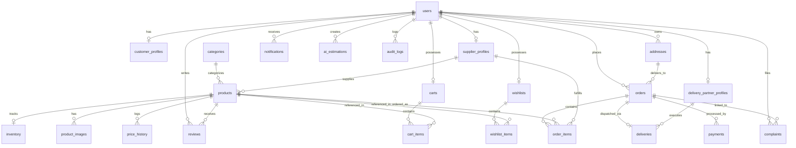

# SMART BUILD – Database Entity-Relationship Specification

## 1. Relational Schema Structure (24 Tables)

## 2. Table Summary

| Table | Description | Primary Key | Foreign Keys |
| :--- | :--- | :--- | :--- |
| `users` | Base identity, role-based auth & status | `id` | - |
| `customer_profiles` | Additional profile data for retail & contractor buyers | `id` | `user_id` -> `users.id` |
| `supplier_profiles` | Verified seller information, tax & approval state | `id` | `user_id` -> `users.id` |
| `delivery_partner_profiles` | Courier details, vehicle type & availability | `id` | `user_id` -> `users.id` |
| `categories` | Material classification hierarchy | `id` | - |
| `products` | Construction materials catalog | `id` | `supplier_id`, `category_id` |
| `product_images` | Gallery & primary asset URLs | `id` | `product_id` -> `products.id` |
| `inventory` | Real-time stock, reserved inventory, thresholds | `id` | `product_id` -> `products.id` |
| `carts` | User active shopping carts | `id` | `user_id` -> `users.id` |
| `cart_items` | Quantity & unit price snapshots | `id` | `cart_id`, `product_id` |
| `addresses` | Multi-address book (billing/shipping/site) | `id` | `user_id` -> `users.id` |
| `orders` | Transaction master records | `id` | `user_id`, `delivery_address_id` |
| `order_items` | Line items with quantity & unit price | `id` | `order_id`, `product_id`, `supplier_id` |
| `payments` | Gateway transactions, signatures & statuses | `id` | `order_id`, `user_id` |
| `deliveries` | Real-time shipment status, tracking & POD | `id` | `order_id`, `delivery_partner_id` |
| `reviews` | Verified product feedback & 1-5 ratings | `id` | `product_id`, `user_id` |
| `wishlists` | Customer saved items | `id` | `user_id` -> `users.id` |
| `wishlist_items` | Wishlist product entries | `id` | `wishlist_id`, `product_id` |
| `notifications` | Targeted event alerts & status updates | `id` | `user_id` -> `users.id` |
| `complaints` | Customer support tickets & disputes | `id` | `user_id`, `order_id` |
| `price_history` | Audit log of supplier price adjustments | `id` | `product_id`, `changed_by_user_id` |
| `ai_estimations` | User estimation history, inputs & computed quantities | `id` | `user_id` -> `users.id` |
| `ai_predictions` | Predictive ML cache (price trend, demand forecast) | `id` | `product_id`, `category_id` |
| `audit_logs` | Admin action audits for security & compliance | `id` | `user_id` -> `users.id` |
